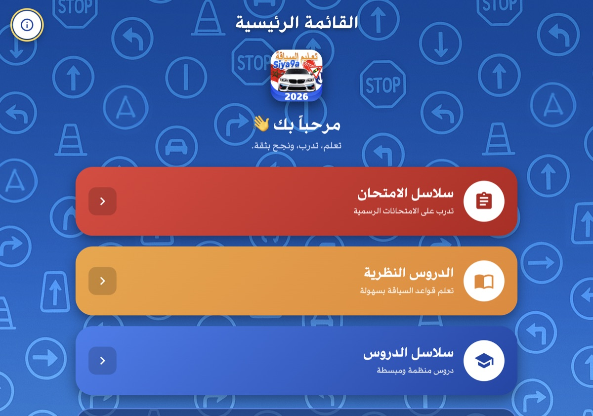
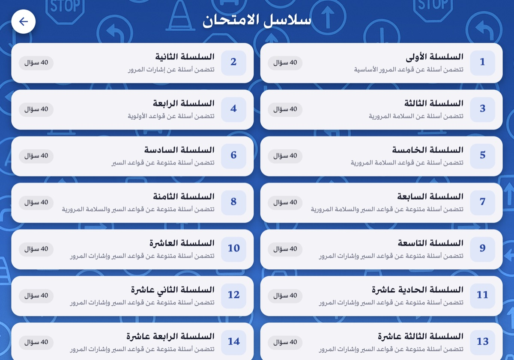

# Siya9a — تعليم السياقة

**تعلم، تدرب، ونجح بثقة.** 
برنامج الحاسوب لتحضير امتحان رخصة السياقة بالمغرب

### [⬇️ تحميل آخر إصدار](https://github.com/siya9a2026/siya9a2026/releases/latest)

---

## ✨ المحتوى

| | |
|---|---|
| 📝 **19 سلسلة امتحان** | 40 سؤالاً لكل سلسلة، بنفس طريقة الامتحان الرسمي |
| 🎓 **12 سلسلة دروس** | دروس منظمة ومبسطة مع التصحيح |
| 📖 **13 درساً نظرياً** | التشوير الطرقي، المركبة، المخالفات |
| ⭐ **امتحان تجريبي** | 40 سؤالاً عشوائياً من جميع السلاسل |
| 🔊 **شرح صوتي** | لكل سؤال وكل إشارة |
| 📴 **بدون إنترنت** | يعمل البرنامج كاملاً بدون اتصال |

## ⬇️ التحميل

افتح [صفحة آخر إصدار](https://github.com/siya9a2026/siya9a2026/releases/latest) واختر الملف المناسب لجهازك:

| الجهاز | الملف |
|---|---|
| 🪟 **Windows** (32 و 64 بت) | `Siya9a-Setup-x.x.x.exe` |
| 🍎 **Mac** بشريحة Apple (M1، M2، M3، M4) | `Siya9a-x.x.x-arm64.dmg` |
| 🍎 **Mac** بمعالج Intel | `Siya9a-x.x.x-x64.dmg` |

> **كيف أعرف نوع جهاز Mac؟** قائمة Apple ← حول هذا الماك. إذا ظهر «Apple M…» اختر `arm64`، وإذا ظهر «Intel» اختر `x64`.

## 🛠️ التثبيت

**Windows**
1. شغّل ملف `exe`.
2. إذا ظهرت رسالة «Windows protected your PC»: اضغط **More info** ثم **Run anyway**.

**Mac**
1. افتح ملف `dmg` واسحب **Siya9a** إلى مجلد **Applications**.
2. إذا رفض macOS فتح البرنامج: **إعدادات النظام ← الخصوصية والأمان** ← اضغط **Open Anyway**.

## 🔑 التفعيل

عند أول تشغيل، أدخل **مفتاح الترخيص** الخاص بمؤسستك.
- المفتاح صالح لمدة **سنة واحدة** ويعمل على جميع حواسيب المؤسسة.
- يُدخل المفتاح مرة واحدة فقط، ولا يحتاج التفعيل إلى الإنترنت.
- لمعرفة تاريخ انتهاء الترخيص: اضغط على أيقونة **ⓘ** في القائمة الرئيسية.

## 🔄 التحديثات

- **Windows:** يتم التحديث تلقائياً عند فتح البرنامج، ويُثبَّت عند إغلاقه.
- **Mac:** تظهر رسالة «نسخة جديدة متوفرة» مع زر التحميل.
- يمكنك أيضاً الضغط على **ⓘ ← التحقق من التحديثات** في أي وقت.

---

© 2026 Siya9a — كل الحقوق محفوظة

